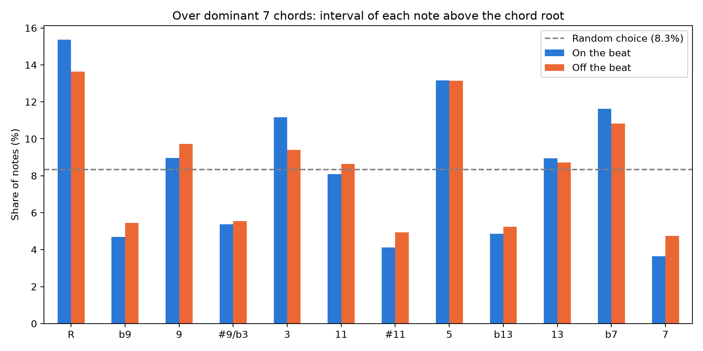

# Learning to Improvise from Data

**How can the implicit rules of jazz improvisation be learned from data, and turned into a practice tool for a classically trained pianist?**

## Motivation

I studied classical piano for seven years : a lot of repertoire and score reading, but no improvisation. Jazz musicians learn to improvise by ear, absorbing rules that are rarely written down: which notes fit which chord, where to place them in the bar, how to connect phrases. This project tries to make those rules explicit and measurable, and to use them to improve my own playing.

## Approach

1. **Analyze**: quantify how jazz soloists choose notes relative to the underlying chord (chord tones on strong beats, tensions, chromatic approach notes), and compare data-learned rules with jazz theory.
2. **Generate**: propose improvised lines over the chord progression of a jazz standard, starting with a chord-conditioned Markov chain.
3. **Give feedback**: record my own piano improvisation over a standard with a microphone, transcribe it with Fourier-based signal processing, and score it against the chords.

A side question: **do pianists improvise like horn players?** Most transcribed solos come from saxophone and trumpet, so I will compare them with piano solos on features that do not require chord labels (interval sizes, chromaticism, rhythmic density).

## Data

- [Weimar Jazz Database](https://jazzomat.hfm-weimar.de/) v2.1: 456 jazz solos transcribed note by note, with hand-annotated chords and beats (ODbL license, not redistributed here).
- [Jazz Trio Database](https://transactions.ismir.net/articles/186): 1,294 piano solos transcribed to MIDI, without chord labels, for the piano vs. horns comparison.
- The Real Book (jazz standards lead sheets), recommended by my professor Brian Dolan : chord progressions of standards used as practice material for generation and feedback (not redistributed here).

## First results (phases 0–1)

Each note of 456 solos is matched to the chord sounding at that moment and encoded as an interval above the chord root: `interval = (pitch - root) mod 12`.

| Measure | Value |
| --- | --- |
| Notes that are chord tones | 49.1%, vs **32.5%** if notes were chosen at random |
| Chord tones on strong beats (1 and 3) | 51.2% |
| Chord tones off the beat | 48.1% |
| Non-chord tones resolving by a half step onto a chord tone | 19.3% |

- Soloists clearly target chord tones, about 1.5× more than chance.
- The textbook rule "chord tones on strong beats" is weaker than expected: only about 3 points between strong beats and off-beats.
- Over dominant chords, the 9th and 13th appear about as often as chance, roughly twice as often as other tensions (b9, #11, b13): they behave like core vocabulary, not "wrong notes".
- About 1 in 5 non-chord tones is a chromatic approach note.
- Limitation: only 3 piano solos have usable chord labels, so the piano vs. horns comparison needs the Jazz Trio Database (next step).

## Roadmap

| Phase | Content | Concepts |
| --- | --- | --- |
| 0. Data & representation | Align each note with its chord, encode it as an interval above the chord root | SQL, pandas, time alignment, music theory |
| 1. Analysis | How soloists choose notes by chord and beat; pianists vs. horn players | Conditional probability, chance baselines, note classification |
| 2. Generation | Lines over the chord progression of a Real Book standard with a chord-conditioned Markov chain, exported to MIDI | Markov chains as weighted graphs, sampling, evaluation against real solos |
| 3. Listening & feedback | Transcribe microphone recordings of my playing over a standard and score them against its chords | Fourier transform (FFT, spectrogram, chromagram), pitch and onset detection |
| Future work | Deep generator, real-time feedback | LSTM / small Transformer conditioned on chords |

## Status

Phases 0–1 done. Next: piano vs. horns comparison and Markov-chain generator.